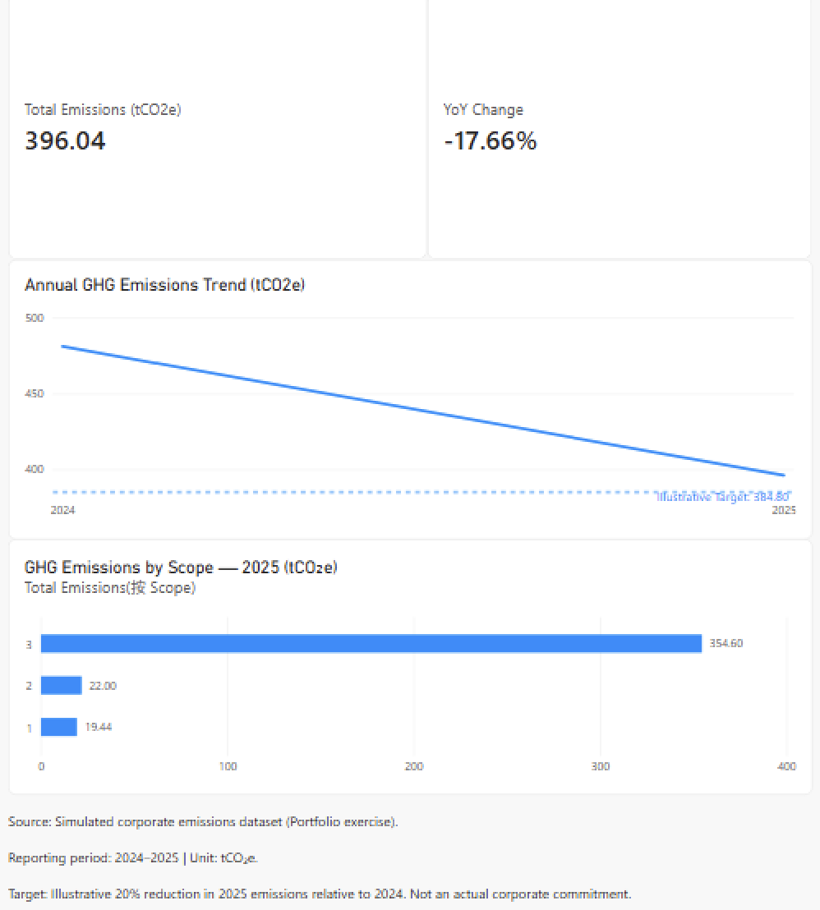

# Corporate GHG Emissions Analytics

**Python · SQL · Power BI | Sustainability Data Analytics**

> **Portfolio disclaimer:** This project uses simulated corporate greenhouse gas (GHG) emissions data. It does not represent a real company's verified emissions inventory or reduction commitments.

## 1. Project Overview

This project analyzes reported GHG emissions and year-on-year changes from 2024 to 2025 using a simulated corporate emissions dataset. It combines data cleaning, SQL-based analysis, and dashboard visualization to identify major emission sources, highlight data quality concerns, and support potential emissions reduction decisions.

For a short summary, see the [One-page Project Overview](reports/Corporate_Emissions_Project_Overview_v1.md).

## 2. Dashboard Preview

*Power BI dashboard showing reported annual emissions, year-on-year change, and emissions by Scope. The reduction target shown in the dashboard is illustrative.*

[View the Power BI project (.pbix)](PowerBI/corporate_emissions_optimization.pbix) — requires Power BI Desktop on Windows. The Power Query source path may need updating to the downloaded CSV before refreshing.

## 3. Key Findings

**1. Reported GHG emissions declined.** Emissions decreased from **481.00 tCO₂e (2024)** to **396.04 tCO₂e (2025)**, a **17.66%** decline. Differences in reporting coverage mean this should not be attributed to successful mitigation without further verification.

**2. Scope 3 dominated reported emissions.** Scope 3 contributed **354.60 tCO₂e**, or **89.54%** of reported emissions in 2025. These figures describe the activities in this dataset, not a complete corporate inventory.

**3. Purchased steel was the largest reported source.** Purchased steel accounted for **342.00 tCO₂e**, or **96.45%** of reported Scope 3 emissions in 2025. Steel procurement is therefore a candidate for further investigation, subject to cost, feasibility, and data reliability.

For detailed interpretation, see [Business Findings & Recommendations](reports/Corporate_Emissions_Business_Findings_v1.md).

## 4. Technical Stack

| Tool | Application |
|---|---|
| **Python / Pandas** | Clean Scope labels, handle missing emissions, remove duplicates, and validate records |
| **SQLite / SQL** | Aggregate emissions, compare years and Scopes, and rank emission sources |
| **Power Query** | Prepare the original CSV for Power BI reporting |
| **Power BI / DAX** | Build KPI measures and visualize emissions trends and the Scope breakdown |
| **Markdown** | Document results, assumptions, and limitations |

## 5. Data Architecture

The project contains **two separate workflows**, rather than one automatically integrated pipeline.

**Workflow A — Python and SQL**

`data/raw/corporate_emissions_dirty_v1.csv` → [Python cleaning notebook](Cororate_Emissions_cleaning_pipline.ipynb) → `data/processed/corporate_emissions_clean.csv` → SQLite database → [SQL analysis notebook](Corporate_Emission_SQL_Analysis_v1.ipynb) and [five SQL queries](Corporate_Emissions_5_Queries.sql).

**Workflow B — Power BI**

Original simulated CSV → Power Query transformations → Power BI data model and DAX measures → dashboard.

The Power BI dashboard **does not directly consume** the Python-processed CSV. The two workflows can be compared, but agreement in reported totals does not independently validate the source records.

## 6. Methodology & Limitations

- **Simulated data:** All records are synthetic and intended for portfolio demonstration.
- **Calculation inconsistency:** The 2024 purchased steel record reports **390.00 tCO₂e**, whereas activity data multiplied by its emission factor gives **380.00 tCO₂e**. Existing non-missing values are not automatically corrected by the cleaning pipeline.
- **Year-to-year comparability:** A natural gas boiler contributes **30.00 tCO₂e** in 2024 but has no corresponding record in 2025. The activity boundary therefore needs checking before interpreting the decline.
- **Emission-factor provenance:** The sources and units of the factors have not been independently verified.
- **Incomplete Scope 3 coverage:** Only selected value-chain activities are included.
- **Illustrative target:** The dashboard's 20% reduction target is an analytical example, not an actual corporate commitment.

These constraints limit the conclusions that can be drawn about actual emissions performance or the effectiveness of reduction measures.

## 7. How to Run

1. **Download or clone** this repository and open its root folder in VS Code / Jupyter. The notebooks use `Path.cwd()`, so the **current working directory must be the repository root**.
2. **Python cleaning:** Open [`Cororate_Emissions_cleaning_pipline.ipynb`](Cororate_Emissions_cleaning_pipline.ipynb) and run all cells. The notebook reads `data/raw/corporate_emissions_dirty_v1.csv` and writes `data/processed/corporate_emissions_clean.csv`.
3. **SQL analysis:** Open [`Corporate_Emission_SQL_Analysis_v1.ipynb`](Corporate_Emission_SQL_Analysis_v1.ipynb) and run all cells. It reads the processed CSV, populates `data/processed/corporate_emissions.db`, and executes the analysis queries. The standalone SQL file is [`Corporate_Emissions_5_Queries.sql`](Corporate_Emissions_5_Queries.sql).
4. **Power BI:** Open [`PowerBI/corporate_emissions_optimization.pbix`](PowerBI/corporate_emissions_optimization.pbix) in Power BI Desktop on Windows. If necessary, update the Power Query source to the repository's original simulated CSV and refresh. This dashboard was developed independently of the Python / SQL workflow.

**Environment note:** The notebooks require a Python environment with their imported packages installed. Their relative paths work when run from the repository root; the Power BI file may still contain a machine-specific data-source path.
